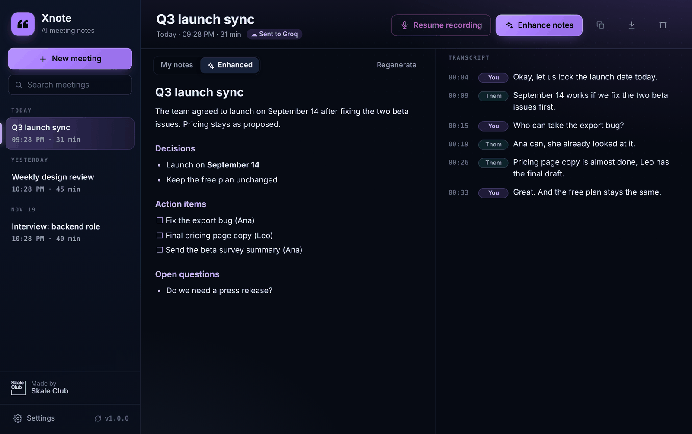
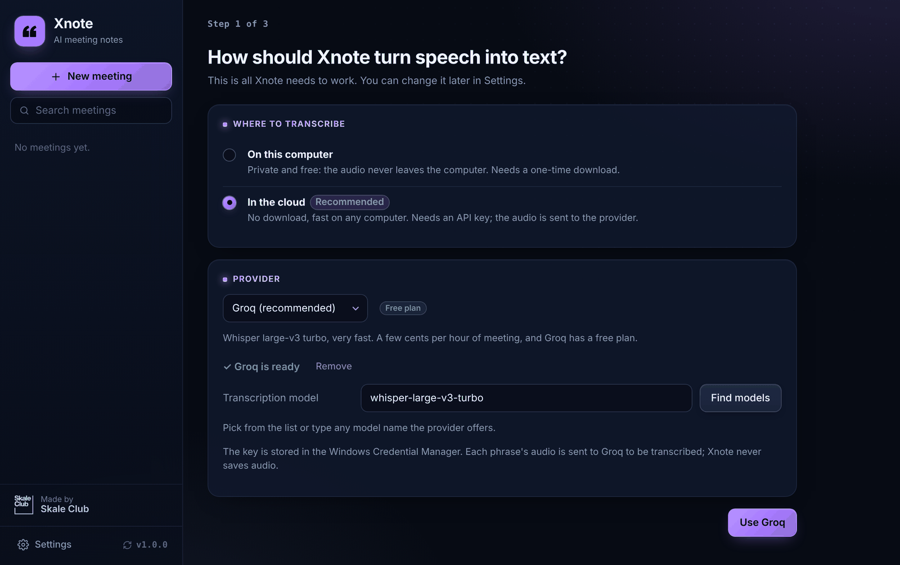
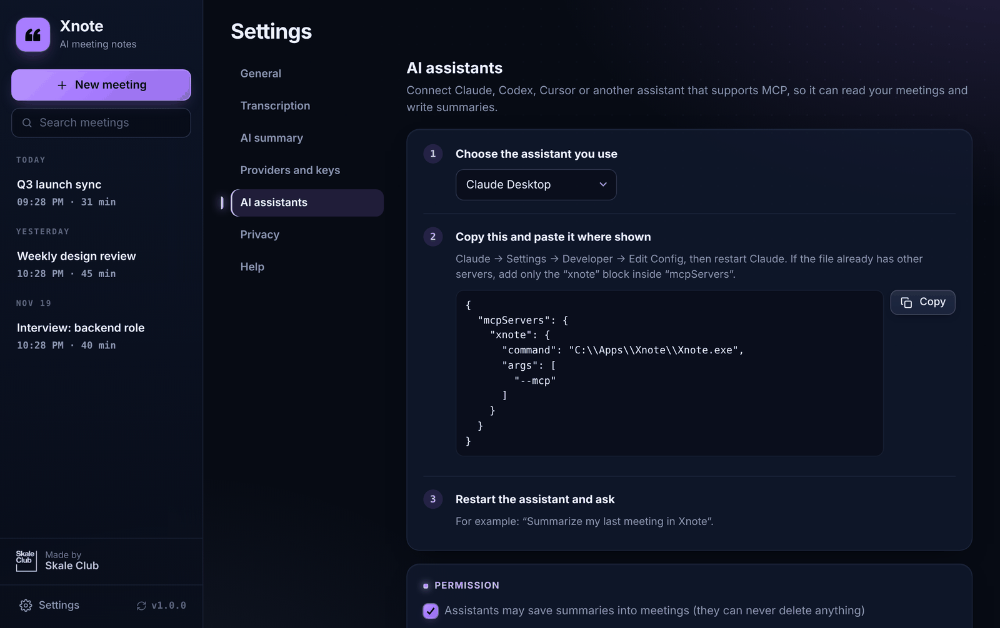

# Xnote

Free meeting transcription and AI notes for Windows, by **[Skale Club](https://skale.club)**.
Xnote captures your microphone and the computer's audio, so it works alongside Zoom, Meet, Teams,
WhatsApp and any other call app, with no meeting bot. The transcript appears while you talk; an
optional AI summary turns your notes and the transcript into clear notes with decisions and tasks.

Xnote is free and open source ([MIT](LICENSE)). It has no account and no subscription: it runs on
**your computer**, or with **your own API key** from the provider you choose.

[Português](#português) · [Español](#español) · [Development and releases](docs/DEVELOPMENT.md)



## Get started

1. Download `Xnote.exe` from [Releases](https://github.com/Skale-Club/xnote/releases) and put it in a
   folder of your own (for example `C:\Apps\Xnote`). It is portable: no installer.
2. Open it. A short guided setup asks two questions, with step-by-step instructions for each choice:
   - **How to transcribe:** on this computer (free, private, one-time download) or with a cloud
     provider (fast on any computer).
   - **AI summary (optional):** none, AI on this computer (Ollama or LM Studio), or a provider with
     your own key.
3. Click **New meeting → Start recording**, take notes, then **Stop**.



## What does it cost?

| Setup | Transcription | Summary | Cost |
|---|---|---|---|
| Everything on your PC | whisper.cpp (built in) | none, or Ollama / LM Studio | **Free**, works offline |
| Free plans | Groq | Groq, Gemini, OpenRouter (`:free` models), Mistral | **Free** within the provider's limits |
| Pay per use | Groq or OpenAI | OpenAI, Anthropic (Claude), OpenRouter, Gemini, Mistral, DeepSeek | Billed by the provider to your own account |

You can also add any **OpenAI-compatible** address (a company gateway or a server on your PC). Model
lists come from the provider, so new models work without an Xnote update. Provider prices and free
plans change; check the provider's site. API billing is separate from consumer chat subscriptions.

## Privacy in short

- **On this computer:** with local transcription and no summary (or Ollama / LM Studio), nothing
  leaves the PC. Each meeting shows **Only on this PC** or the services that received it.
- **With a provider:** audio goes to the transcription provider; notes and transcript go to the
  summary provider, under that provider's data policy.
- **Files:** meetings are JSON files in `Data` beside the exe; API keys are in the Windows
  Credential Manager. Xnote keeps no recording.

Details: [Data and privacy](docs/PRIVACY.md) · [Limits and troubleshooting](docs/TROUBLESHOOTING.md)

## Use with Claude, Codex, Cursor and other AI assistants

`Xnote.exe --mcp` runs Xnote as a local [MCP](https://modelcontextprotocol.io) server, with no window,
so the AI assistant you already use can read your meetings and write summaries, without an API key
in Xnote. The assistant starts it when needed; no network port is opened. **Settings → AI assistants**
shows the configuration for each assistant, with your exe path, ready to copy.



Claude Code:

```bash
claude mcp add --scope user xnote -- "C:\Apps\Xnote\Xnote.exe" --mcp
```

Claude Desktop (Settings → Developer → Edit Config) and Cursor (`%USERPROFILE%\.cursor\mcp.json`):

```json
{ "mcpServers": { "xnote": { "command": "C:\\Apps\\Xnote\\Xnote.exe", "args": ["--mcp"] } } }
```

Codex, in `%USERPROFILE%\.codex\config.toml`:

```toml
[mcp_servers.xnote]
command = 'C:\Apps\Xnote\Xnote.exe'
args = ["--mcp"]
```

Then ask, for example, “Summarize my last meeting in Xnote”. Tools:

- `list_meetings`, `get_meeting` (`id`), `search_meetings` (`query`, `limit`): read the meetings.
- `save_summary` (`id`, `markdown`): saves the assistant's notes as the meeting's enhanced notes, so
  they appear in Xnote. Can be turned off in Settings; nothing is ever deleted.
- `app_info`, `transcription_status`: version, folders and setup (never API keys).
- Prompt `summarize_meeting` (`id`): Xnote's own summary instructions plus the meeting.

What the assistant reads goes to its AI provider, as with anything else you share with it. ChatGPT
connects only to servers on the internet, not to apps on your PC, so it cannot use Xnote directly.

## Development

Tauri 2, Rust and plain HTML/CSS/JavaScript. See the [development and release
guide](docs/DEVELOPMENT.md) for prerequisites, clone, build, test and signed-release instructions.

## Português

O Xnote é **gratuito e de código aberto** ([MIT](LICENSE)): transcreve reuniões e organiza
anotações com IA. Captura o microfone e o áudio do Windows; funciona junto de qualquer app de
chamada, sem robô na reunião. Não tem conta nem assinatura: roda **no seu computador** ou com **a
sua própria chave de API**.

- **Começar:** baixe o `Xnote.exe` em [Releases](https://github.com/Skale-Club/xnote/releases),
  coloque numa pasta sua e abra. A configuração guiada faz duas perguntas, com um passo a passo
  para cada escolha.
- **Transcrição:** no computador (whisper.cpp, grátis e privado, funciona sem internet) ou na nuvem
  (Groq, OpenAI ou um endereço compatível). Na nuvem, os trechos de áudio vão para o provedor.
- **Resumo com IA (opcional):** desligado, IA no seu computador (Ollama ou LM Studio) ou um
  provedor com a sua chave (Groq, OpenAI, OpenRouter, Claude, Gemini, Mistral, DeepSeek). O Xnote
  grava e transcreve normalmente sem resumo.
- **Custos:** tudo no PC é grátis; Groq, Gemini, OpenRouter e Mistral têm planos grátis; os demais
  cobram por uso direto na sua conta do provedor. A API é cobrada à parte das assinaturas de chat.
- **Dados:** arquivos ficam em `Data` ao lado do executável; chaves ficam no Gerenciador de
  Credenciais do Windows. O app não salva áudio. Os arquivos de reunião não têm criptografia própria.
- **Limites:** distingue “Você” de “Eles”, sem separar cada participante remoto. A transcrição
  pode atrasar. O Xnote se atualiza sozinho e instala a versão nova quando você o fecha.
- **Claude Code e Codex:** `Xnote.exe --mcp` deixa o Claude, o Codex, o Cursor e outros assistentes lerem as reuniões e salvarem resumos, sem chave de API no Xnote. Veja
  [Use with Claude, Codex, Cursor and other AI assistants](#use-with-claude-codex-cursor-and-other-ai-assistants).

## Español

Xnote es **gratis y de código abierto** ([MIT](LICENSE)): transcribe reuniones y organiza apuntes
con IA. Captura el micrófono y el audio de Windows, sin añadir un bot a la llamada. No tiene cuenta
ni suscripción: funciona **en tu equipo** o con **tu propia clave de API**.

- **Empezar:** descarga `Xnote.exe` en [Releases](https://github.com/Skale-Club/xnote/releases),
  ponlo en una carpeta tuya y ábrelo. La configuración guiada hace dos preguntas, con un paso a paso
  para cada opción.
- **Transcripción:** en el equipo (whisper.cpp, gratis y privado, funciona sin internet) o en la nube
  (Groq, OpenAI o una dirección compatible). En la nube, los fragmentos de audio van al proveedor.
- **Resumen con IA (opcional):** desactivado, IA en tu equipo (Ollama o LM Studio) o un proveedor con
  tu clave (Groq, OpenAI, OpenRouter, Claude, Gemini, Mistral, DeepSeek). Xnote graba y transcribe
  igual sin resumen.
- **Costes:** todo en el PC es gratis; Groq, Gemini, OpenRouter y Mistral tienen planes gratis; los
  demás cobran por uso en tu cuenta del proveedor. La API se factura aparte de las suscripciones de chat.
- **Datos:** archivos en `Data` junto al ejecutable; claves en el Administrador de credenciales. No
  se guarda audio. Los archivos de reunión no tienen cifrado propio.
- **Límites:** distingue “Tú” y “Ellos”, sin identificar a cada participante remoto. Puede haber
  retrasos. Xnote se actualiza solo e instala la versión nueva cuando lo cierras.
- **Claude Code y Codex:** `Xnote.exe --mcp` deja que Claude, Codex, Cursor y otros asistentes lean las reuniones y guarden resúmenes, sin clave de API en Xnote.
  Consulta [Use with Claude, Codex, Cursor and other AI assistants](#use-with-claude-codex-cursor-and-other-ai-assistants).

## Skale Club apps

These Windows apps belong to the [Skale-Club organization](https://github.com/Skale-Club).
They share navy interfaces, blue accents, transparent product symbols, and English,
Portuguese and Spanish UI text. Each app has its own executable and portable Data folder.

| App | Purpose |
| --- | --- |
| [Xpace](https://github.com/Skale-Club/xpace) | Care for the PC (disk space, cleaning, drivers, startup, apps) and inspect hardware, live sensors and benchmarks |
| [Xink](https://github.com/Skale-Club/xink) | Draw over the screen during presentations or recordings |
| [Xnote](https://github.com/Skale-Club/xnote) | Transcribe meetings and turn notes into summaries and tasks |
| [Xvert](https://github.com/Skale-Club/xvert) | Convert videos, music and pictures between formats |

Report problems through the
relevant repository, including app version, Windows version and reproduction steps. Remove
personal information from reports and transcripts before sharing.


---

© 2026 [Skale Club](https://skale.club)
